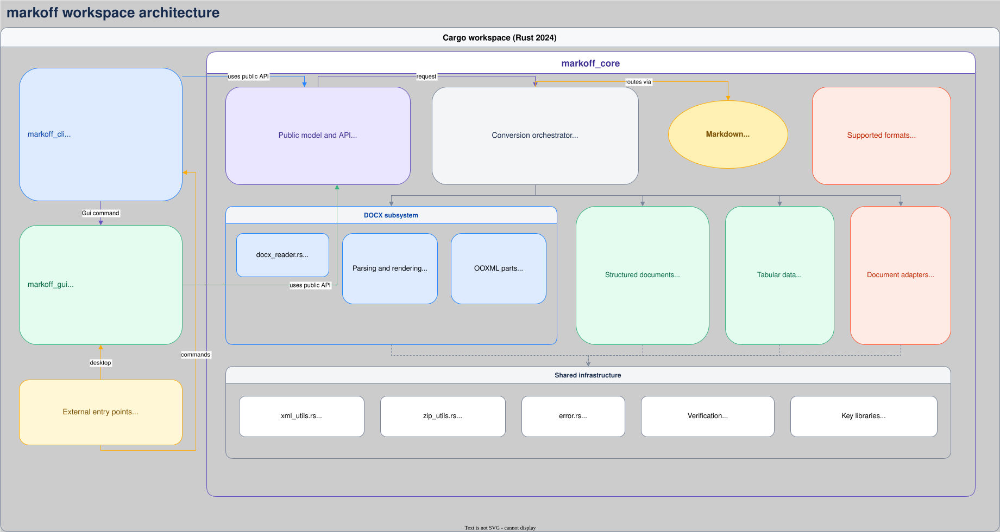

# markoff

[Русская версия](docs/README.ru.md)

markoff is a Rust workspace for a bi-directional converter between Microsoft Office documents and Markdown / structured data formats. The workspace, conversion baseline, GUI workflow, quality gates, benchmarks, and release pipeline are in place.

## Current status

The project has moved beyond the initial stub stage:

- Workspace structure is complete
- Core crate contains the format model and conversion pipeline
- Text and tabular conversion paths are available, including XLSX
- CLI supports single-file, batch, and text stream workflows
- GUI provides a local conversion queue with previews and drag-and-drop

### Implemented

- Cargo workspace with three crates: `markoff_core`, `markoff_cli`, and `markoff_gui`
- `vergen 10` build metadata in CLI `--version` and GUI About dialog
- GitHub Actions CI on Windows and Linux for formatting, Clippy, tests, and release builds
- GitHub Artifact Attestations for each release executable and its downloadable archive
- Shared `Format` enum and file-extension detection
- Conversion request validation and typed error handling
- Whole-document conversion from Markdown/DOCX/ODT/PDF/PPTX/ODP/HTML to a typed
  JSON/YAML/TOML document schema, and back to Markdown/DOCX/ODT/PDF/PPTX/ODP/HTML; inline
  formatting, lists, links, footnotes, code metadata, and rich table cells are
  represented as typed nodes
- Direct conversion between JSON, YAML, and TOML values
- Real text conversion support for:
  - `JSON <-> Markdown`
  - `CSV <-> Markdown`
- `Markdown Tables <-> XLSX`, including multi-sheet workbooks, frozen header rows, and fitted column widths
- `Markdown Tables <-> ODS`, including multi-sheet workbooks
- `JSON / CSV / YAML / TOML <-> XLSX` for arrays of objects and tabular sheets
- `JSON / CSV / YAML / TOML <-> ODS` for arrays of objects and typed tabular cells
- `DOCX <-> Markdown` for headings, paragraphs, tables, nested bulleted/numbered lists, bold/italic/strikethrough/underline text, inline and fenced code, blockquotes, horizontal rules, footnotes/endnotes, bookmarks, images, and `PAGEREF` links
- `ODT <-> Markdown` for supported document structure and inline formatting
- `DOCX -> HTML` through Markdown, preserving supported document elements
- `DOCX tables -> CSV / XLSX / JSON / YAML / TOML`, plus `CSV / XLSX -> DOCX`
- PDF text-layer detection per page, with configurable `oar-ocr`, `oar-ocr-vl`, or API OCR for textless pages
- Shared Markdown-backed routes between document formats, plus an optional persistent JSON intermediate for editable conversion chains
- `PPTX <-> Markdown` for slide titles, body text/bullets, images, tables, and charts (as data tables)
- legacy `DOC`, `XLS`, and `PPT` input through `office_oxide`, and output through LibreOffice
- `ODP <-> Markdown` for slide titles, body text/bullets, images, and tables
- `HTML <-> Markdown` for headings, emphasis, links, images, lists, blockquotes, code blocks, and tables
- `PDF / PPTX / HTML -> JSON / YAML / TOML` and JSON/YAML/TOML back to Markdown, DOCX, PDF, PPTX, or HTML
- CLI `convert` with text stdin/stdout and `batch` with glob patterns and progress bars
- GUI conversion queue with file picker, drag-and-drop, all core formats, convert-selected/convert-all actions, an optional output folder, a compatible-pairs-only **Tables only** toggle, style tools, in-app help, and format-aware previews
- Unit, integration, and property-based core tests covering DOCX and XLSX round-trips

### Still pending

- PPTX/ODP slides are re-laid out automatically: exact shape positions, themes, animations, and speaker notes are not preserved; charts become data tables; SVG images are embedded in ODP but appear as alt text in PPTX output

## Architecture



Open the [embedded SVG diagram](docs/architecture/markoff-architecture.drawio.svg) directly in the Draw.io Integration extension or [diagrams.net](https://app.diagrams.net/). The SVG retains the editable draw.io data for both pages: **Architecture** shows crate and module dependencies, while **Repository layout** maps the complete workspace structure, build assets, tests, and documentation.

## Getting started

Install the current stable [Rust toolchain](https://www.rust-lang.org/tools/install), clone the repository, and build the workspace from its root:

```powershell
cargo build --workspace
```

Run the test suite before using a locally built version:

```powershell
cargo test --workspace
```

The commands below use `cargo run` during development. A release build is created with `cargo build --release`; the CLI executable is `target/release/markoff` (or `markoff.exe` on Windows) and the GUI executable is `target/release/markoff_gui` (`markoff_gui.exe`). The Cargo package names stay `markoff_cli` and `markoff_gui`, so `-p markoff_cli` selects the CLI package; the executable names are set by the `[[bin]]` sections in each crate's `Cargo.toml`.

PDF import and export use `pdfium-render`. The build pins PDFium chromium/8125
for each target and verifies the upstream archive SHA-256 before embedding it.
This adds roughly 30 MB to each application binary. On first PDF conversion it
is extracted to the user's cache; no network access or separately installed
Pdfium library is required at runtime. PDF output embeds fonts with Cyrillic
support and renders supported document structure, formatting, links, code,
tables, footnotes, and raster images.

PDF output uses the embedded DejaVu fonts for broad Unicode coverage and Twemoji
graphics for emoji fallback. DejaVu fonts are distributed under their bundled
free-font license; Twemoji graphics are copyright their contributors and
licensed under CC-BY 4.0.

### Use the executable file

To use the application without `cargo run`, build the release binary once:

```powershell
cargo build --release -p markoff_cli
```

In PowerShell, run the executable from the repository root with its relative path:

```powershell
.\target\release\markoff.exe --help
.\target\release\markoff.exe --version
.\target\release\markoff.exe convert .\report.csv --to md
```

To call `markoff.exe` from any directory, copy it to a directory already listed in the `PATH` environment variable, or add `target\release` to `PATH` for the current PowerShell session:

```powershell
$env:Path += ";$PWD\target\release"
markoff.exe convert .\report.csv --to md
```

On Linux and macOS, use `./target/release/markoff` instead. The commands in the following sections show the development form with `cargo run`; replace `cargo run -p markoff_cli --` with the executable path to run the same command from the compiled application.

### Verify an official release

The GitHub release workflow creates a signed build-provenance attestation for
each executable and release archive. After installing the GitHub CLI, verify a
downloaded file against this repository:

```powershell
gh attestation verify .\markoff.exe --repo PavelKotDRM/markoff
gh attestation verify .\markoff_gui.exe --repo PavelKotDRM/markoff
```

Use the Linux executable names (`markoff`, `markoff_gui`) or archive path as
appropriate. This verifies the artifact's provenance and integrity; it is not
an Authenticode or Apple Developer ID code-signing certificate.

## Command line

Display the list of commands and supported arguments:

```powershell
cargo run -p markoff_cli -- --help
cargo run -p markoff_cli -- convert --help
cargo run -p markoff_cli -- --version
```

### Convert one file

The general command is:

```text
markoff convert INPUT [--from FORMAT] [--to FORMAT] [-o OUTPUT]
```

The source format is detected from the input extension and the target format from `--to` or the output extension. Use `--from` when the source format cannot be inferred. When `-o` is omitted, the converted file is written next to the source file with the target extension. If the destination file already exists, the command fails with an error unless `--overwrite` is given. The input file is never overwritten, even with `--overwrite`.

```powershell
# CSV to a Markdown table; creates .\report.md
cargo run -p markoff_cli -- convert .\report.csv --to md

# Markdown to DOCX with an explicit output path
cargo run -p markoff_cli -- convert .\notes.md -o .\output\notes.docx

# Markdown to OpenDocument Text
cargo run -p markoff_cli -- convert .\notes.md -o .\output\notes.odt

# DOCX to Markdown
cargo run -p markoff_cli -- convert .\report.docx --to markdown

# PDF to Markdown
cargo run -p markoff_cli -- convert .\report.pdf --to markdown

# Markdown or DOCX to PDF
cargo run -p markoff_cli -- convert .\notes.md -o .\notes.pdf
cargo run -p markoff_cli -- convert .\report.docx --to pdf

# Structured document or data to PDF
cargo run -p markoff_cli -- convert .\report.json --to pdf
cargo run -p markoff_cli -- convert .\settings.yaml --to pdf

# Markdown table to an XLSX workbook
cargo run -p markoff_cli -- convert .\scores.md -o .\scores.xlsx

# Markdown tables to an ODS workbook
cargo run -p markoff_cli -- convert .\scores.md -o .\scores.ods

# JSON array of objects to XLSX
cargo run -p markoff_cli -- convert .\people.json --to xlsx

# XLSX to JSON
cargo run -p markoff_cli -- convert .\people.xlsx -o .\people.json

# Overwrite an existing output file
cargo run -p markoff_cli -- convert .\report.csv --to md --overwrite

# CSV with a semicolon delimiter
cargo run -p markoff_cli -- convert .\report.csv --to md --delimiter ';'

# Tab-separated values
cargo run -p markoff_cli -- convert .\report.csv --to md --delimiter tab
```

Supported format identifiers are `docx`, `odt`, `pdf`, `md`/`markdown`, `xlsx`/`xlsm`, `ods`, `json`, `csv`, `yaml`/`yml`, `toml`, `pptx`, `odp`, and `html`/`htm`. PDF pages with usable embedded text use it directly; textless pages require configured OCR (see below). Document formats can convert through shared Markdown-backed routes, including PDF to DOC/DOCX. PDF export preserves supported document elements, embeds PNG/JPEG/GIF/BMP/WebP images, makes internal links and HTTP(S)/mailto/tel links clickable, and exposes headings in the PDF outline. It reflows content onto A4 pages rather than reproducing source pagination or precise page layout. SVG images are not currently supported by PDF export. PPTX/ODP conversion keeps slide titles, text, bullets, images (extracted next to the Markdown in `image/`), and tables; PPTX charts are exported as data tables. Exact shape layout, themes, animations, and speaker notes are not preserved.

### Editable intermediate and round trips

```powershell
cargo run -p markoff_cli -- convert .\report.docx --to md --keep-intermediate
# Creates report.md and the actual final-stage input report.md.intermediate.json.
cargo run -p markoff_cli -- convert .\report.md.intermediate.json --to toml
cargo run -p markoff_cli -- convert .\report.md.intermediate.toml --to yaml
cargo run -p markoff_cli -- convert .\report.md.intermediate.yaml -o .\restored.docx
```

`--keep-intermediate` uses a self-contained JSON document (including base64 image
assets) as the input to the final exporter, and retains it even if export fails.
Both output files honor `--overwrite`; neither may overwrite the source.
Edit the intermediate and convert it again to change the final document.
The GUI has **Keep JSON intermediate**, **Intermediate JSON** preview, and
**OCR / conversion config...** controls. Batch conversion accepts the same flags
and creates one intermediate per result. Stdout cannot retain an intermediate.

Supported headings, inline styles, lists, tables, links, code, footnotes and
images survive the document schema chain. XLSX/ODS conversions retain typed
cell values and sheet names rather than passing them through Markdown strings.
JSON/YAML/TOML workbook data can be imported again, including multi-sheet
objects and the `rows` wrapper emitted for a single-sheet TOML file.
For JSON root arrays/scalars or values containing `null`, TOML uses the reserved
`__markoff_json_value_v1` string containing editable JSON; markoff unwraps it on
import. This preserves values that TOML cannot represent natively.
This is not lossless Office archival: macros, unsupported objects/styles,
presentation graphics, pagination and exact layout are not retained. Legacy
DOC output still requires LibreOffice. Markdown and CSV cannot represent every
Office feature; keep the JSON intermediate for the richest supported structure.

### OCR configuration

OCR is lazy and page-specific: text pages do not load models or contact an API.
With OCR disabled, a textless page produces an explicit error instead of an
apparently successful empty conversion. An empty successful OCR response retains
the page's images (or a rendered page when there are no extractable images).
Extracted PDF images remain associated with their source pages.

Local OCR backends are included in every build. Model weights are downloaded
only when the selected configuration enables `auto_download`:

```powershell
cargo build --release -p markoff_cli
cargo run -p markoff_cli -- convert .\scan.pdf --to md --config .\docs\examples\ocr-auto.toml
```

Choose a configuration:

- [Automatic local OCR](docs/examples/ocr-auto.toml): downloads registered models on first use.
- [Offline local OCR](docs/examples/ocr-local.toml): explicit ONNX files and their matching dictionary.
- [Layout-aware VL OCR](docs/examples/ocr-vl.toml): automatic checkpoints or local model/layout directories.
- [OCR API](docs/examples/ocr-api.toml): sends textless page images to a configured server.

Pass `--config FILE` (or set `MARKOFF_CONFIG`) for CLI conversion/batch, or choose
the file in the GUI. Local paths are resolved relative to the config file.
Downloads are opt-in, use upstream oar caching (`OAR_HOME`, otherwise `~/.oar`),
and can require several GB for VL. Local OCR uses `device = "auto"` by default:
it selects an available GPU provider compiled into the application and falls
back to CPU; set `device = "cpu"` to force CPU inference.

GPU providers are opt-in build features so ordinary CPU builds do not require
GPU toolchains:

```powershell
# NVIDIA CUDA for both backends (requires CUDA Toolkit with nvcc and a compatible driver).
cargo build --release -p markoff_cli --features markoff_core/ocr-cuda
# AMD/NVIDIA/Intel Windows GPUs through DirectML in the oar ONNX backend.
cargo build --release -p markoff_cli --features markoff_core/ocr-directml
# Apple CoreML for oar; Metal for oar_vl.
cargo build --release -p markoff_cli --features markoff_core/ocr-coreml,markoff_core/ocr-metal
```

`ocr-cuda` enables CUDA for both local backends. DirectML and CoreML apply to
`oar`; Metal applies to `oar_vl`. GPU inference through `oar` additionally
requires an ONNX Runtime shared library that includes the selected provider.
`oar_vl` uses Candle and does not require ONNX Runtime. AMD GPUs on Windows can
use DirectML with `oar`; AMD Linux currently falls back to CPU because ROCm is
not exposed by the OCR integration. GPU availability depends on the provider
runtime, driver, and model support. The `oar` backend requires an installed ONNX
Runtime shared library (1.24 or newer recommended). Set `ORT_DYLIB_PATH` to its
full path, e.g.
`$env:ORT_DYLIB_PATH = 'C:\onnxruntime\lib\onnxruntime.dll'`; on Linux/macOS,
use `libonnxruntime.so` / `libonnxruntime.dylib`. Without this variable, the
platform library name is used. Dynamic loading avoids native-library copying
assumptions in upstream build scripts and reports load failures explicitly.
The Candle-based `oar_vl` backend and API backend do not require ONNX Runtime.
Choose recognition weights/dictionaries appropriate for the document languages;
OCR quality depends on the models and scans and is not guaranteed.

The API endpoint receives one JSON POST per textless page:

```json
{"page": 2, "mime_type": "image/png", "image_base64": "<base64 PNG>"}
```

It must return `{"markdown":"recognized page Markdown"}`. Page numbers are
one-based; rendered images are bounded to 2000 x 3000 pixels. Inline image data
URIs are supported in the returned Markdown; server-local image paths are not
portable. `token_env` optionally names an environment variable containing a
bearer token; do not put credentials in the config. HTTP errors, invalid
responses, timeouts and local model failures propagate as conversion failures;
requests are not redirected or retried. API OCR sends page images to the
configured server: use a trusted endpoint and HTTPS for non-local servers.

`--delimiter` sets the CSV field delimiter (a single character, or the word `tab`); it defaults to a comma and applies wherever CSV is read or written (`convert` and `batch`, including through XLSX/DOCX intermediates).

### Standard input and output

Use `-` as the input path to read from standard input and as the output path to write to standard output. Both ends must be text formats: Markdown, JSON, CSV, YAML, or TOML. Specify both formats when neither filename can provide them.

```powershell
'{"name":"Ada","active":true}' | cargo run -p markoff_cli -- convert - --from json --to markdown -o -

Get-Content .\table.csv | cargo run -p markoff_cli -- convert - --from csv --to md -o -
```

Binary Office files (`.doc`, `.docx`, `.odt`, `.xls`, `.xlsx`, `.xlsm`, `.ods`, `.ppt`, `.pptx`, `.odp`) cannot be read from stdin or written to stdout.

Legacy `.doc`, `.xls`, and `.ppt` input is converted to OOXML with
`office_oxide`. Writing legacy files requires a separately installed
LibreOffice: add `soffice` or `libreoffice` to `PATH`, or set
`MARKOFF_LIBREOFFICE` to the executable path. Legacy files are converted through
OOXML intermediates; conversion may change unsupported formatting or discard
macros and embedded objects.

### Batch conversion

Convert every matching file in a directory. The output directory is created by the converter when needed.

```powershell
# Convert all DOCX files from .\documents into Markdown files in .\converted
cargo run -p markoff_cli -- batch .\documents --pattern '*.docx' --to md -o .\converted

# Convert CSV files to XLSX workbooks
cargo run -p markoff_cli -- batch .\exports --pattern '*.csv' --to xlsx -o .\workbooks
```

As with `convert`, pass `--overwrite` to replace output files that already exist; otherwise a matching existing destination file stops the batch with an error.

The pattern is relative to the supplied directory. The progress indicator advances for converted files; conversion stops and returns an error when a matching file cannot be read or an individual input is unsupported or invalid.

## Graphical application

Start the GUI directly during development or via the CLI command:

```powershell
cargo run -p markoff_gui
cargo run -p markoff_cli -- gui
```

1. Select **Add files** or drag files into the application window.
2. Choose the desired target format in **Convert to**. Output filenames update automatically when you change the target format.
3. Use **Output** to choose a shared destination folder, or keep **Next to source**.
4. Choose **Convert selected** for one file or **Convert all** for pending and failed queue entries.
5. Inspect the source and result previews. Hover over a queue status for the output path or error.

The toolbar also offers **Tables only** for supported document ↔ JSON/YAML/TOML conversions, a CSV delimiter, dark/light themes, and **Help** with supported formats and limitations. Successful items are skipped by **Convert all** unless overwrite is enabled. Adding the same source path twice does not create a duplicate job.

PDF, HTML, DOC/DOCX, and ODT output can optionally use a TOML style theme:

```powershell
markoff convert report.md --to pdf --style docs\examples\style-theme.toml
```

The same file can be selected with **Style → Choose...** in the GUI.
Create a starting theme from an existing Office file with
`markoff style-import reference.doc -o theme.toml`; the GUI also offers
**Style → Import...** for DOC/DOCX, XLS/XLSX/XLSM, PPT/PPTX, and ODS sources.
Legacy input files are read with `office_oxide`; legacy output uses the
LibreOffice dependency described above. Imported formatting is mapped to the
theme properties supported by markoff; details
that cannot be represented by a theme keep their defaults.
To start from an editable template containing every setting with its default
value and a comment, run `markoff style-template -o theme.toml` (omit `-o` to
print to stdout; add `--overwrite` to replace an existing file). In the GUI,
**Export template...** saves the template for any target format without
changing the selected theme, while **Style → New...** saves it, selects it, and
opens the preview.
**Preview** opens a sample with the page size, margins, header/footer, H1–H6
headings, body text, a link, inline code, a quote, a list, a code block, a
striped table, a horizontal rule, and all resolved values; it also reloads a
theme edited on disk.
**Clear** restores the built-in formatting. If no theme is selected, each
format keeps its existing built-in formatting. Themes
control body text (font, size, color, spacing, line height, alignment,
first-line indent), headings (font, per-level colors and sizes, spacing, bold,
italic), the page (size, orientation, margins, header/footer text with
{page}/{pages}), links, blockquotes, lists, code, tables (including striped
rows), horizontal rules, footnotes, and image width. PDF embeds its bundled
Unicode fonts, so font-family names affect HTML, DOCX, and ODT; image width
applies to PDF and HTML, and HTML page settings apply when printing.

## Format behavior and limitations

- DOCX, ODT, and Markdown preserve supported headings, paragraphs, nested ordered and bulleted lists, tables, bold/italic/strikethrough/underline text, inline and fenced code blocks, blockquotes, horizontal rules, footnotes, bookmarks, and links. `PAGEREF` fields are specific to DOCX. Structured JSON/YAML/TOML also preserve inline formatting, list numbering, table alignment, and fenced-code info strings.
- DOCX endnotes use separate Markdown labels, such as `[^endnote-i]` for lower-Roman numbering or `[^endnote-1]` for decimal numbering. Their definitions are written at the end of the Markdown file. Returning these labels to DOCX preserves the endnote type and Roman/decimal numbering. The GUI Markdown preview supports SVG images, including their text.
- PDF to Markdown, JSON, YAML, or TOML extracts the document text layer with Pdfium and embedded raster images with `lopdf` (saved as files next to Markdown or embedded in structured output). Page layout, vector graphics, tables, and scanned text are not preserved, and images are appended after the text rather than placed at their original position.
- Markdown, DOCX, and JSON/YAML/TOML to PDF renders supported document structure, inline formatting, nested lists, aligned tables, code blocks, blockquotes, footnotes, links, bookmarks, and embedded raster images. Long code lines wrap inside their shaded blocks, including across pages. Headings are added to the PDF outline; internal links and HTTP(S)/mailto/tel links remain clickable. Other URI schemes are printed as text. Content is reflowed onto new A4 pages, so original pagination and exact page placement are not retained. JSON/YAML/TOML document schemas are rendered as documents; other valid values are printed as formatted source code. SVG images are not supported for PDF output.
- Markdown tables convert to and from XLSX and ODS. Each `## Sheet name` heading represents a workbook sheet; the first table row becomes the frozen header row in XLSX.
- Markdown/DOCX/ODT/PDF/PPTX/ODP/HTML to JSON/YAML/TOML and back preserve supported document structure as an ordered `blocks` array with typed inline `content`, nested list items, footnote definitions and references, links, bookmarks, images, and rich table `cells`. Older `text` and table `rows` documents remain readable. `--tables-only` retains table blocks.
- Images embedded in a DOCX or PDF are extracted and saved as files in an `image` folder next to the Markdown output, referenced with standard `` syntax. Shapes, SmartArt, and charts in DOCX are emitted as simplified SVG previews; the preview keeps visible labels and chart values, not the original editable object or exact layout. Converting to JSON/YAML/TOML embeds image data as base64, and converting structured data back to Markdown restores image files. Markdown-to-DOCX re-embeds supported local raster and SVG images as OOXML pictures. SVG images are not supported for PDF output.
- JSON, CSV, YAML, and TOML convert to XLSX or ODS as tabular data. JSON/YAML/TOML input for this route must be an array of objects; this is a separate, table-only convention from the whole-document `blocks` schema above.
- OpenDocument imports append a versioned Markoff service block to Markdown. It contains the complete original ODT/ODS/ODP package. An unchanged Markdown round trip restores the package byte for byte. Text-only edits with the same document structure update `content.xml` while preserving styles, formulas, merged cells, images, charts, slide layouts, speaker notes, metadata, and unknown extension parts. A structural edit that cannot be mapped safely returns an explicit error instead of silently dropping package objects; remove the service block to intentionally create a new document from the visible Markdown.
- Visible ODT/ODS/ODP Markdown is still a simplified editable projection: ODP slide images and tables are extracted for editing, while advanced layout remains losslessly preserved by the service block. PDF output reflows content and does not retain source pagination or exact placement. PPTX conversion keeps slide text, images, tables, and chart data, but not exact layout or speaker notes.

## Rust code quality

Install the standard formatting and linting components once:

```powershell
rustup component add rustfmt clippy
```

Use these commands from the workspace root for the usual development checks:

```powershell
# Fast compile check without producing binaries
cargo check --workspace --all-targets --all-features

# Format the workspace, or only verify formatting in CI
cargo fmt --all
cargo fmt --all -- --check

# Run all Clippy lints used by this workspace
cargo clippy --workspace --all-targets --all-features

# Treat every Clippy warning as an error (recommended before a commit)
cargo clippy --workspace --all-targets --all-features -- -D warnings

# Run all tests, including documentation tests
cargo test --workspace --all-targets --all-features
cargo test --workspace --doc

# Verify that API documentation builds without dependency documentation
cargo doc --workspace --all-features --no-deps
```

Cargo and Clippy can apply some suggestions automatically. Review the diff afterward; `--allow-dirty` permits changes when the working tree already contains edits:

```powershell
cargo fix --workspace --all-targets --all-features --allow-dirty
cargo clippy --fix --workspace --all-targets --all-features --allow-dirty
git diff
```

Optional third-party tools can check dependency vulnerabilities, outdated packages, and unused dependencies:

```powershell
cargo install cargo-audit cargo-outdated cargo-machete
cargo audit --deny warnings
cargo outdated --workspace
cargo machete
```

Update the installed Rust toolchain and inspect project dependencies with:

```powershell
rustup update
cargo tree --workspace
cargo update --dry-run
```

### Run benchmark

```powershell
cargo bench -p markoff_core --bench conversion
```

## Code quality checks

Run these commands from the workspace root to validate code quality with standard Rust tooling:

```powershell
# 1) Formatting check (rustfmt)
cargo fmt --all -- --check

# 2) Lints and static analysis (Clippy)
cargo clippy --workspace --all-targets

# 3) Unit/integration/doctests
cargo test --workspace

# 4) Documentation build (catches doc issues)
cargo doc --workspace --no-deps
```

For CI-grade strictness, make Clippy fail the build on warnings:

```powershell
cargo clippy --workspace --all-targets -- -D warnings
```

## Verification

The current core implementation is verified with:

```bash
cargo test -p markoff_core --quiet
```

and is passing successfully at the moment.

## Notes

The core engine and both user interfaces are implemented for the documented workflows. Contributions can extend format coverage, improve conversion fidelity, and refine the CLI and GUI experience.
